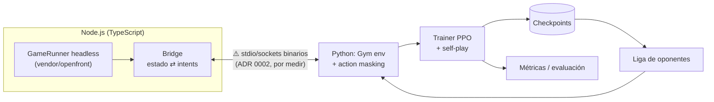
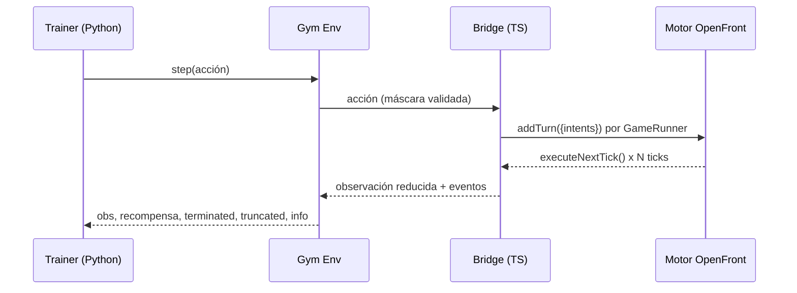
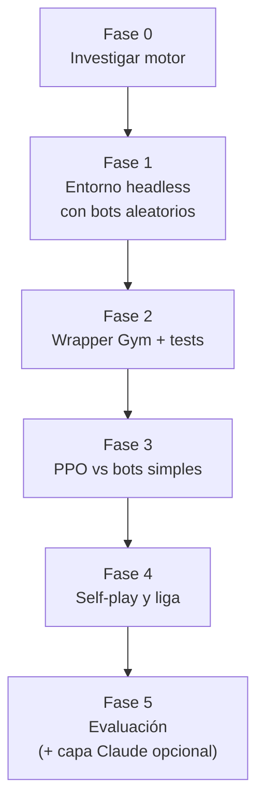

# Arquitectura de openfront-rl

> Estado: **Fase 0 completada, Fase 1 (lado TypeScript) hecha** (ver `docs/research/engine-findings.md`). Lo marcado con ⚠️ sigue siendo propuesta o está sin medir; los ADRs 0002–0004 están en estado "propuesta" hasta validarse en la Fase 1.
>
> Resumen de la Fase 0: el motor corre sin navegador a ~190–490 ticks/s por proceso (el juego real va a 10), es determinista (mismo hash con la misma semilla) y acepta 25 tipos de intents. Requiere Node 24.15+ y npm 12.1+.

## 1. Visión general

## 2. Bucle de interacción

## 3. Componentes

| Componente | Lenguaje | Responsabilidad | Spec |
|---|---|---|---|
| Motor | TS | Simulación (no se toca). Se usa `GameRunner` como librería (ADR 0003) | n/a |
| Bridge | TS | Armar la partida, aplicar intents, construir observaciones reducidas | ⚠️ pendiente (Fase 1) |
| Gym env | Python | Observaciones, acciones, máscaras, recompensa | `specs/observations.md`, `specs/actions.md`, `specs/reward.md` |
| Trainer | Python | PPO, rollouts paralelos, checkpoints | ⚠️ pendiente |
| Liga | Python | Gestión de oponentes para self-play | ⚠️ pendiente |

## 4. Puntos de decisión abiertos (ADRs)

1. ~~Headless y velocidad~~ **Resuelto en la Fase 0**: sí corre sin cliente, ~190–490 ticks/s por proceso (medido en la nube; repetir en tu PC). ADR 0003.
2. **Puente TS ⇄ Python**: propuesta stdio/sockets binarios (ADR 0002), por medir en la Fase 1.
3. **Representación de observaciones**: capas tipo imagen + vector global. El mapa World tiene 2 M de tiles (2000×1000), hay que reducirlo; existe un `miniGameMap` por confirmar.
4. **Espacio de acciones**: jerárquico con máscaras. El motor ofrece `playerActions()`/`playerBuildables()` para saber qué es válido.
5. **Recompensa**: victoria (>80 % de la tierra, o mayor territorio al acabar el tiempo) + término ligero de territorio.
6. **Algoritmo y oponentes**: PPO; currículo tribus → naciones → liga de checkpoints (ADR 0004).

## 5. Fases

| Fase | Entregable | Criterio de salida |
|---|---|---|
| 0 ✅ | Informe de investigación + ADRs 0002–0004 | Se sabe si es viable headless y a qué velocidad |
| 1 🟡 | Partida completa headless con política aleatoria (lado TS hecho: `bridge/`, ver `docs/research/phase1-results.md`) | Reproducible con semilla ✅. Falta medir en tu PC y el IPC con Python (pasa a Fase 2) |
| 2 | `OpenFrontEnv` (Gymnasium) | Tests de contrato pasan |
| 3 | Agente PPO | Curva de recompensa sube frente a bots simples |
| 4 | Self-play y liga | Gana de forma consistente a checkpoints anteriores |
| 5 | Evaluación y reportes | Métricas reproducibles |

## 6. Riesgos

- **Velocidad de simulación**: la medida es buena (20–50× tiempo real por proceso), pero sin medir en partidas largas ni en paralelo → medir en la Fase 1.
- **Motor sin API pública estable** → fijar el commit del submódulo; cambios de versión vía ADR.
- **Licencia AGPL v3 del motor** → decidir la licencia del proyecto antes de publicar (ver `engine-findings.md` §10).
- **Recompensa explotable** → mantenerla simple y vigilar comportamientos degenerados.
- **Espacio de acciones demasiado grande** → jerarquía y máscaras.
