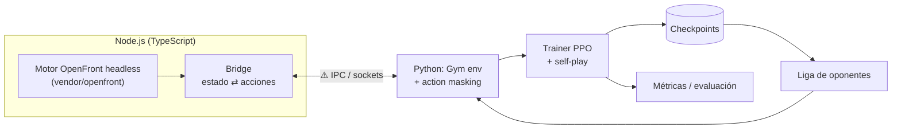
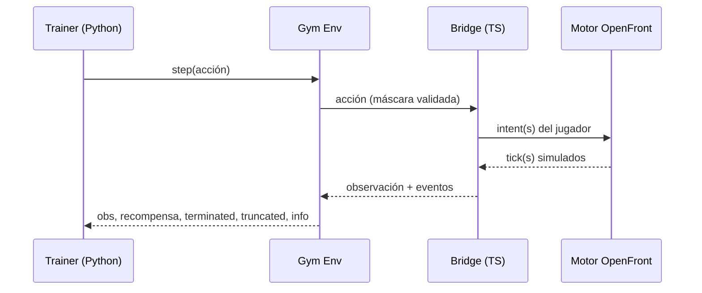
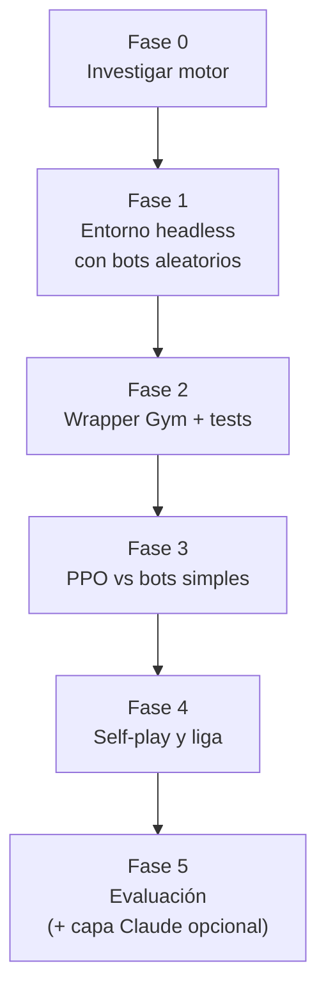

# Arquitectura de openfront-rl

> Estado: **borrador inicial (Fase 0)**. Las partes marcadas con ⚠️ dependen de la investigación del motor y se confirmarán con ADRs.

## 1. Visión general

## 2. Bucle de interacción

## 3. Componentes

| Componente | Lenguaje | Responsabilidad | Spec |
|---|---|---|---|
| Motor | TS | Simulación (no se toca) | n/a |
| Bridge | TS | Headless, serializar estado, aplicar acciones | ⚠️ pendiente |
| Gym env | Python | Observaciones, acciones, máscaras, recompensa | `specs/observations.md`, `specs/actions.md`, `specs/reward.md` |
| Trainer | Python | PPO, rollouts paralelos, checkpoints | ⚠️ pendiente |
| Liga | Python | Gestión de oponentes para self-play | ⚠️ pendiente |

## 4. Puntos de decisión abiertos (ADRs)

1. **Headless y velocidad**: ¿el motor corre sin cliente y cuántos ticks/segundo alcanza?
2. **Puente TS ⇄ Python**: sockets, memoria compartida, o política exportada a ONNX.
3. **Representación de observaciones**: capas tipo imagen + vector global.
4. **Espacio de acciones**: jerárquico con máscaras.
5. **Recompensa**: victoria + término ligero de territorio.
6. **Algoritmo**: PPO y diseño de self-play.

## 5. Fases

| Fase | Entregable | Criterio de salida |
|---|---|---|
| 0 | Informe de investigación + ADRs 0002-0003 | Se sabe si es viable headless y a qué velocidad |
| 1 | Partida completa headless con bots aleatorios | Reproducible con semilla |
| 2 | `OpenFrontEnv` (Gymnasium) | Tests de contrato pasan |
| 3 | Agente PPO | Curva de recompensa sube frente a bots simples |
| 4 | Self-play y liga | Gana de forma consistente a checkpoints anteriores |
| 5 | Evaluación y reportes | Métricas reproducibles |

## 6. Riesgos

- **Velocidad de simulación insuficiente** → paralelizar instancias o simplificar el mapa.
- **Motor acoplado al cliente** → extraer lo mínimo desde `bridge/` sin modificar `vendor/`.
- **Recompensa explotable** → mantenerla simple y vigilar comportamientos degenerados.
- **Espacio de acciones demasiado grande** → jerarquía y máscaras.
